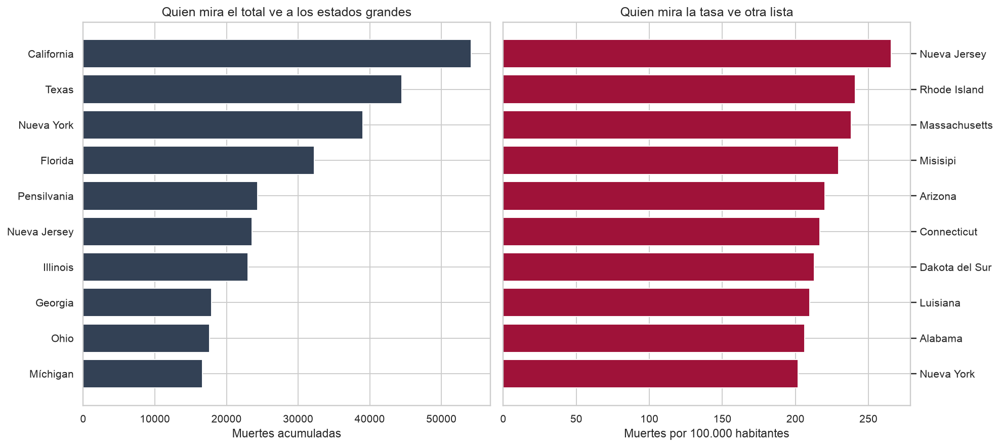
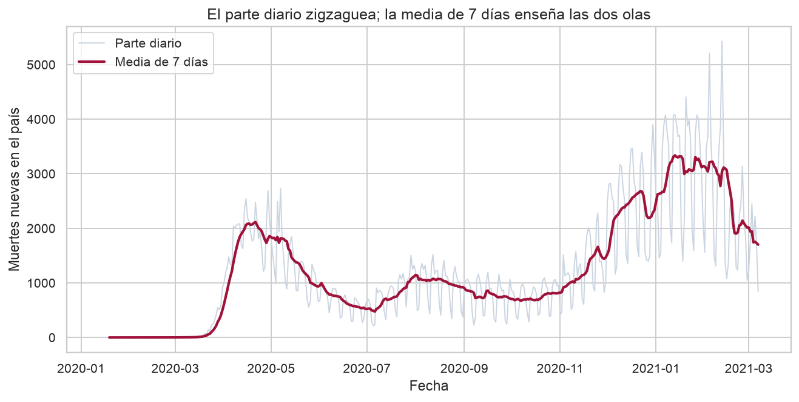
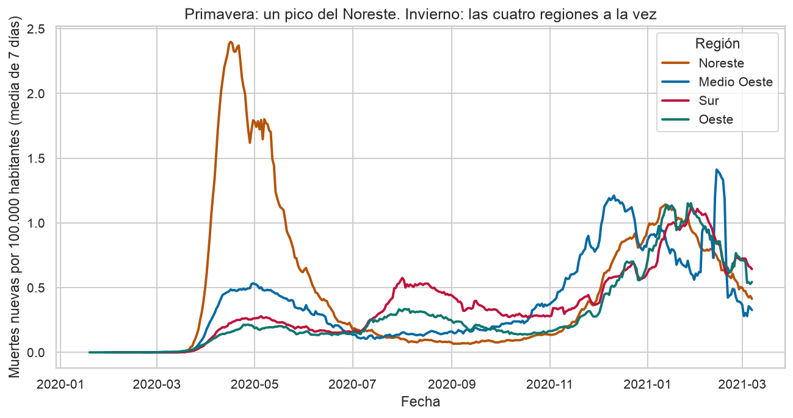

# Qué dicen los datos antes de decidir

COVID-19 en Estados Unidos, del 13 de enero de 2020 al 7 de marzo de 2021. Cifras del COVID Tracking Project y población del censo a 1 de julio de 2020.

El archivo suma **515.151 muertes**. En los 50 estados y el Distrito de Columbia eso equivale a **156 muertes por cada 100.000 habitantes**. Tres lecturas cambian lo que conviene hacer con esa cifra.

## 1. El total ordena por tamaño. La tasa ordena por gravedad

California acumula 54.124 muertes, más que ningún otro estado, y queda en 137,5 por cada 100.000 habitantes: por debajo de la media del país. Nueva Jersey, con 23.574 muertes, queda en **265,4 por cada 100.000**. Rhode Island (240,9) y Massachusetts (238,1) van detrás. Hawái cierra la lista, con 31,6.

En las dos listas de diez —la de muertes totales y la de muertes por habitante— solo coinciden Nueva York y Nueva Jersey. Texas, Florida, Pensilvania, Illinois, Georgia, Ohio y Míchigan aparecen arriba porque tienen mucha población. Misisipi, Arizona, Connecticut, Dakota del Sur, Luisiana y Alabama aparecen arriba cuando cada muerte se mide contra los habitantes.

El Sur suma más muertes que ninguna otra región (190.177). En tasa, el Noreste está por encima: **207 por cada 100.000**, frente a 126 en el Oeste.

Cualquier ranking de estados que use el número en bruto está midiendo el tamaño del estado.

## 2. Enero de 2021 fue el peor mes del país. Abril de 2020 fue el peor golpe del Noreste

Enero de 2021 suma 95.387 muertes nuevas. Abril de 2020 suma 55.315. El 13 de enero de 2021 la media de siete días llega a **3.335 muertes diarias**. El parte de un solo día no sirve para leerlo: domingo y lunes publican menos, porque el fin de semana el dato llega tarde, y el gráfico diario parece una sierra.

Esa media nacional esconde dos geografías. En el Noreste, la media de siete días por habitante marca el máximo el **16 de abril de 2020**, cerca de 2,4 muertes diarias por cada 100.000 habitantes, el doble de lo que sufrió cualquier región en el invierno. En enero de 2021 las cuatro regiones están altas a la vez, alrededor de una muerte diaria por cada 100.000. Por eso el total del país es mayor en invierno: el golpe dejó de ser local.

## 3. Detectar más casos por habitante no fue lo mismo que morir más

Utah acumula unos 11.500 casos por cada 100.000 habitantes, de los más altos del país, y la letalidad aparente es del 0,5%: de cada mil casos detectados murieron cinco personas. En Nueva Jersey, con menos casos por habitante (unos 9.150), murieron 29 de cada mil casos detectados.

La correlación entre casos y muertes en bruto es 0,97. En tasas por habitante baja a 0,63. Entre casos por habitante y letalidad aparente es −0,09: las dos cifras se mueven por separado.

Este archivo no trae la edad de la población. Sin eso no hay forma seria de explicar por qué Utah y Nueva Jersey se separan. Lo que sí queda dicho es que la diferencia no se lee en la columna de casos.

Los casos de la primavera, además, están más subcontados. A mediados de abril, alrededor de uno de cada cinco tests daba positivo. En enero de 2021 era cerca de uno de cada siete, con mucha más capacidad de diagnóstico. Comparar casos de abril con casos de enero sin mirar la positividad compara dos sistemas de detección distintos.

## Qué no usar para decidir

- Las columnas de anticuerpos, antígenos, ventiladores acumulados o altas hospitalarias: les falta más del 80% de los datos. Rellenarlas inventaría pacientes.
- El parte de un lunes, o el de un estado suelto en un día pico. La media de siete días existe por eso.
- La suma de hospitalizados de la primavera. En los primeros meses casi ninguna jurisdicción publicaba la cifra. Florida no la tiene en el 40% de sus días. La serie de hospitalizados solo se puede leer cuando la cobertura ya es alta; el máximo del país, 6 de enero de 2021, sí lo es.
- Un incremento negativo. No es una muerte que se deshace: es una corrección contable. Conservadas, las correcciones hacen que la suma diaria cuadre exactamente con las 515.151 muertes del 7 de marzo. En los casos el cuadre falla por 96, casi todos en California. No mueven ninguna conclusión y conviene saber que están ahí.

El detalle de columnas, huecos y decisiones está en [calidad_datos.md](calidad_datos.md). El gráfico para explorar las 52 jurisdicciones con población, estado a estado, está en [figuras/muertes_por_100k.html](figuras/muertes_por_100k.html).
